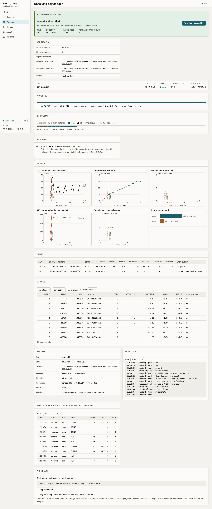
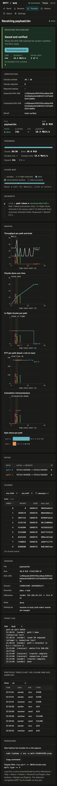
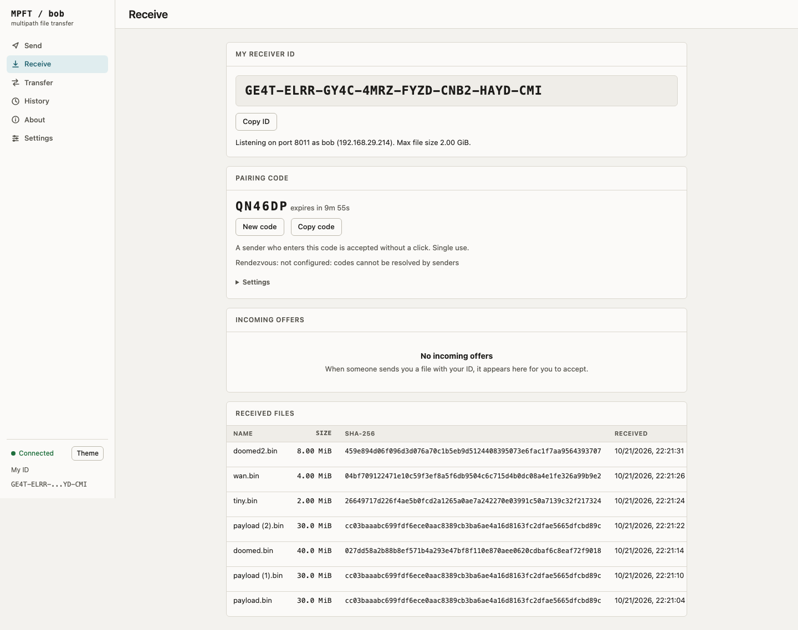
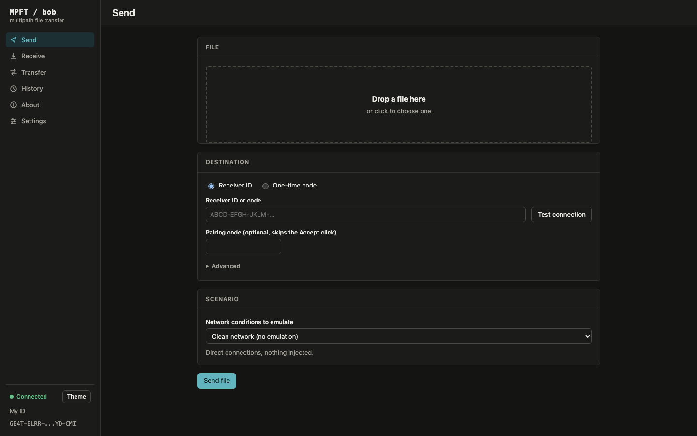

# MPFT: Multipath Reliable File Transfer

Computer Networks project. A file is split into chunks, sent in parallel over several TCP connections
("paths"), and written on the receiver only after SHA-256 verification. The transfer survives a dead path,
corrupted data and interruption (resume).

## Problem statement
A single TCP connection ties a transfer to one route. If that route stalls or breaks the transfer stops, a
damaged file is only discovered at the end, and an interrupted transfer starts again from zero. Most hosts
have more than one usable route (WiFi plus hotspot, several connections). MPFT uses them together and
recovers from failures at chunk level.

## Objectives
1. Aggregate bandwidth by sending chunks over N parallel TCP paths with automatic load balancing.
2. Detect and repair corruption per chunk (SHA-256, NACK, retransmit).
3. Survive path failure by requeueing in-flight chunks on the remaining paths.
4. Resume interrupted transfers without resending verified data.
5. Measure all of this with an emulated network, graphs, a dashboard and Wireshark.

## Architecture
```
 file --pread--> SENDER --- path 0 ---[proxy: delay/rate/kill/corrupt]---> RECEIVER --pwrite--> file.part
                 chunk    --- path 1 ---[proxy]---------------------------> verify SHA-256     |
                 queue    --- path N ---[proxy]---------------------------> rename when whole-file hash OK
                 (work stealing)  <---------- ACK / NACK / DONE -----------
      status/*.json  --->  dashboard (FastAPI)            wireshark/mpft.lua decodes the wire format
```
Details: [docs/ARCHITECTURE.md](docs/ARCHITECTURE.md), [docs/TOPOLOGY.md](docs/TOPOLOGY.md).

## Protocol summary
20-byte big-endian header (`MP`, version, type, session id, chunk index, payload length, CRC-32 of the header),
then payload. Types: HELLO, MANIFEST (JSON with chunk hashes), MANIFEST_ACK (chunks already held), CHUNK, ACK,
NACK, DONE, ERROR. Paths pull chunk indexes from a shared queue (faster paths carry more). Full spec:
[docs/PROTOCOL.md](docs/PROTOCOL.md).

## Requirements
macOS (or any OS with Python), Python 3.11+. Core uses only the standard library. Extras (`requirements.txt`):
pytest, matplotlib, fastapi, uvicorn, markdown, httpx, playwright (browser tests; run `playwright install chromium` once).

## Quick start
```bash
python3 -m venv .venv && source .venv/bin/activate && pip install -r requirements.txt
head -c 50000000 /dev/urandom > /tmp/big.bin

python -m mpft receive --listen 127.0.0.1:9000 --out downloads        # terminal 1
python -m mpft send /tmp/big.bin --to 127.0.0.1:9000 --paths 4        # terminal 2
shasum -a 256 /tmp/big.bin downloads/big.bin
```
Flags: `--paths N`, `--chunk-size 256k`, `--to host:port[,host:port...]`, `--listen`, `--out`, `--bind`, `--csv file`.

## Emulated paths
```bash
python -m mpft emulate --config topology.example.json     # ports 9201-9203 forward to the receiver on 9000
python -m mpft send /tmp/big.bin --to 127.0.0.1:9201,127.0.0.1:9202,127.0.0.1:9203
```
Per path: `delay_ms`, `jitter_ms`, `rate_mbit`, `drop_after_s` (path dies), `corrupt_rate`.

## Two Macs over Tailscale
Receiver: `python -m mpft receive --listen 0.0.0.0:9000 --out downloads`.
Sender: `python -m mpft send file --to 100.x.y.z:9000 --paths 4`. Setup, firewall prompt, hotspot fallback and
caveats about college WiFi and CGNAT: [docs/REMOTE.md](docs/REMOTE.md). (Not yet tested on real hardware.)

## Web interface
One Mac, two instances and two browser tabs:
```bash
python -m mpft web --name alice --ui-port 8000 --peer-port 8001 --data-port 9000 --out ./alice-dl --host 127.0.0.1
python -m mpft web --name bob   --ui-port 8010 --peer-port 8011 --data-port 9010 --out ./bob-dl   --host 127.0.0.1
```
Two Macs: each person runs `python -m mpft web --name NAME --out ./downloads` (with Tailscale installed) and opens
`http://127.0.0.1:8000`. The receiver copies the Receiver ID from the Receive page to the sender, who pastes it on the
Send page. Both people then watch the same live Transfer page: chunk map, paths, graphs, incidents, hash checks and
protocol messages, and past transfers can be replayed from History. No built-in encryption; Tailscale (WireGuard)
encrypts between the Macs. Details, runbooks and troubleshooting: [docs/WEB.md](docs/WEB.md).

### Web UI screenshots
Regenerated by `MPFT_SHOTS=1 .venv/bin/pytest tests/e2e/test_screens.py` (real two-instance transfer, headless Chromium) into `docs/screenshots/ui-<page>-<light|dark>-<1440|1024|390>.png`; `graphs-bob.png` shows the six graphs after a transfer with a killed path.

| Transfer, light, 1440 | Transfer, dark, 390 |
|---|---|
|  |  |
|  |  |

## Dashboard
```bash
python -m mpft dashboard          # http://127.0.0.1:8080, reads status/*.json
```

## Tests and experiments
```bash
pytest -q                                          # 20 tests, about 12 s
python experiments/run_experiments.py              # 50 MB, about 3 minutes; --size-mb, --only baseline,failure
python experiments/plot_results.py                 # PNGs into results/
```

## Results (50 MB, emulated paths, one run each)
| Experiment | Result |
|---|---|
| 1 / 2 / 4 / 8 paths | 23 / 45 / 89 / 172 Mbit/s |
| Paths 80/20/5 Mbit/s | bytes carried 74 % / 20 % / 6 % |
| One of 3 paths dies at 1.5 s | completes, SHA-256 verified, recovery 0.15 s |
| 1 % and 5 % chunk corruption | 2 and 12 retransmissions, all verified |
| Resume after kill at 40 % | 80 of 200 chunks skipped, 5.7 s vs 9.2 s |


Full tables and analysis: [docs/TEST_REPORT.md](docs/TEST_REPORT.md). Raw data: `results/*.csv`.

## Wireshark
`wireshark/mpft.lua` decodes MPFT (`mpft.type`, `mpft.session`, `mpft.chunk`, `mpft.len`, `mpft.crc`).
Capture instructions and screenshot checklist: [wireshark/CAPTURE.md](wireshark/CAPTURE.md).

## Demo
5-minute script with exact commands: [docs/DEMO_SCRIPT.md](docs/DEMO_SCRIPT.md). Viva questions:
[docs/VIVA_PREP.md](docs/VIVA_PREP.md). Code tour: [docs/WALKTHROUGH.md](docs/WALKTHROUGH.md).

## Limitations
- Paths are emulated on one machine; results are not real-network measurements.
- The emulator does not simulate true packet loss (TCP would hide it); corruption is injected above TCP.
- No encryption or authentication by default (use Tailscale/VPN).
- One chunk in flight per path (stop-and-wait), so a single path under-uses its link.
- Experiments ran once per setting, without confidence intervals.
- The two-Mac Tailscale run has not been tested on real hardware.

## Team contributions
See [docs/CONTRIBUTIONS.md](docs/CONTRIBUTIONS.md).

### Scenarios and views (web UI)

The Send form offers eight network scenarios (clean, slow, asymmetric, lossy, heavy loss, path failure, path flap, total failure). The sender and receiver see different Transfer pages, and graphs adapt their time axis (ms for sub-2 s transfers). See `docs/WEB.md`.
