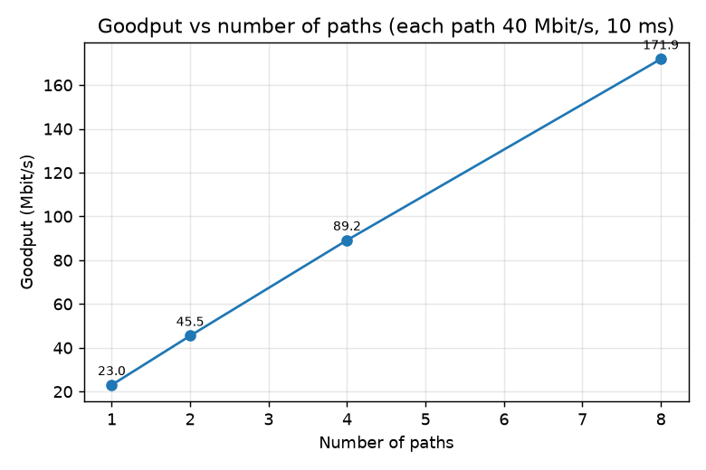
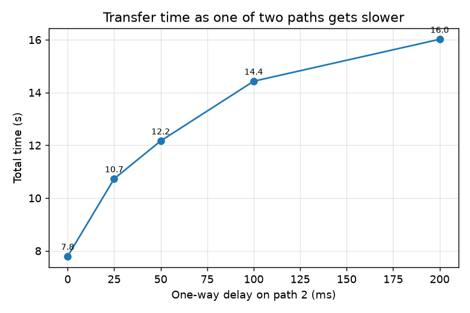
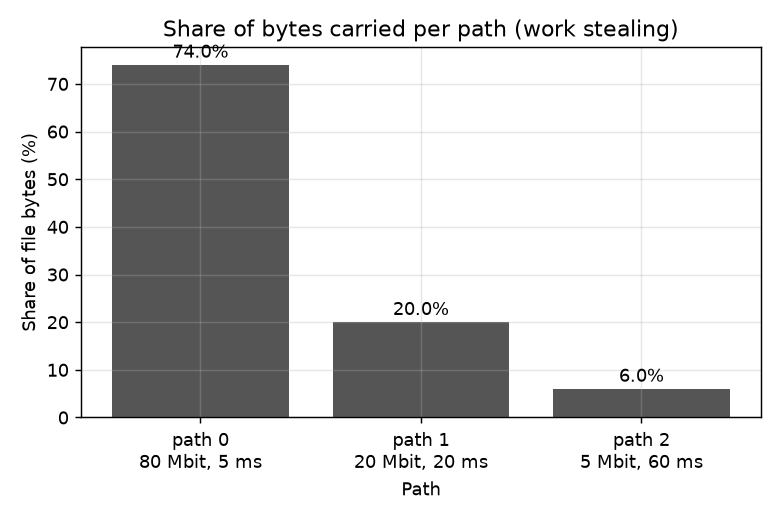
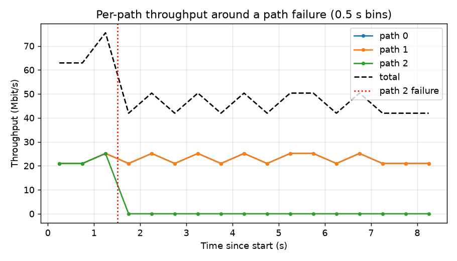
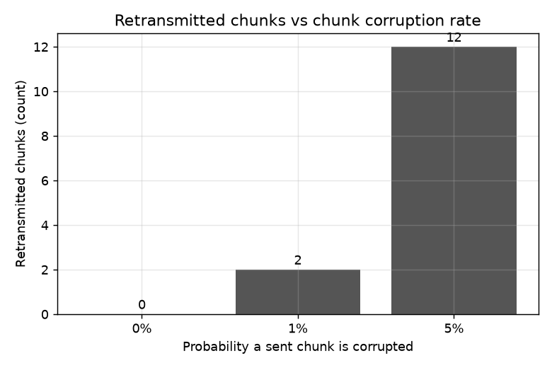
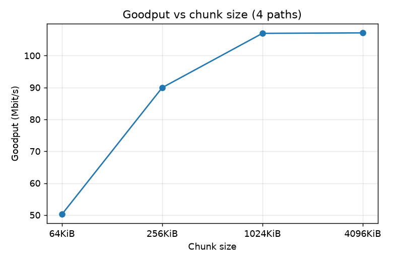

# Test Report

Environment: macOS, Python 3.15 venv, everything on one machine (loopback). Paths are emulated by
`mpft/emulator.py`. Unit tests: `pytest -q` (20 tests, about 12 s). Experiments: `python experiments/run_experiments.py`
with a 50 MB random file, 256 KiB chunks unless stated; raw data in `results/*.csv`. Each experiment ran once,
so small differences between rows are within noise. Default emulated path: 40 Mbit/s, 10 ms one-way delay.

## 1. Automated tests

| ID | Scenario | Expected | Actual | Result |
|---|---|---|---|---|
| U1 | Header is 20 bytes and round-trips | pack/unpack identical | as expected | pass |
| U2 | Header with flipped byte | CRC error raised | `ProtocolError` | pass |
| U3 | Header with wrong magic | rejected | `ProtocolError` | pass |
| U4 | Message with payload over a socket | same type, session, index, payload | as expected | pass |
| U5 | Frame delivered 1 byte at a time | reassembled correctly | as expected | pass |
| U6 | 20 MB, 4 paths, loopback | SHA-256 of output equals input, no `.part` left | match, all bytes counted | pass |
| U7 | Chunk with one flipped bit | NACK, nothing stored; clean resend gets ACK | as expected | pass |
| U8 | Duplicate and out-of-order chunks | all ACKed, file correct after DONE | as expected | pass |
| U9 | Path killed after 1 MiB (proxy dies) | transfer completes via other path, failure recorded | success, hash match | pass |
| U10 | Path goes silent (swallows data), 0.4 s timeout | timeout, other path finishes | success, hash match | pass |
| U11 | `corrupt_rate=0.1` on 2 paths | retransmissions > 0, file correct | as expected | pass |
| U12 | `corrupt_rate=1.0` | gives up after 5 retries, `success=False` | error mentions retries | pass |
| U13 | Resume after interruption (half the chunks stored, receiver restarted) | only the missing half is sent | `resumed_chunks` = half, bytes = half | pass |
| U14 | Resume when a stored chunk is damaged | damaged chunk not trusted, resent | 15 of 16 resumed, hash match | pass |
| U15 | Fast path (1 ms) vs slow path (20 ms, 8 Mbit/s) | fast path carries more than 2x slow | as expected | pass |
| U16 | 1 MiB through 8 Mbit/s limiter | takes about 1 s or more | over 0.8 s | pass |
| U17 | Emulator `drop_after_s` | path dies, survivor finishes | success, path marked dead | pass |
| U18 | Emulator `corrupt_rate=0.02` on both paths | transfer survives | success | pass |
| U19 | Dashboard API with real sender and receiver | both sessions listed, 4/4 chunks, verified | as expected | pass |
| U20 | Dashboard with junk and old status files | junk skipped, old marked stale | as expected | pass |

## 2. Experiments

| ID | Scenario | Expected | Actual (from CSV) | Result |
|---|---|---|---|---|
| E1 | 1/2/4/8 paths, equal paths | goodput grows with paths | 23.0 / 45.5 / 89.2 / 171.9 Mbit/s (18.2 s down to 2.4 s) | pass |
| E2 | Paths 80/20/5 Mbit/s | faster paths carry more | 74 % / 20 % / 6 % of bytes, 7.6 s | pass |
| E3 | 2 paths, one gets 0/25/50/100/200 ms delay (+25 % jitter) | time rises, slow path share falls | 7.8 / 10.7 / 12.2 / 14.4 / 16.0 s; slow path share 58 % down to 16 % | pass |
| E4 | 3 paths, path 2 dies at 1.5 s | completes, SHA-256 verified, fast recovery | success, 8.5 s vs 6.2 s without failure, 1 retransmission, recovery 0.15 s | pass |
| E5 | Chunk corruption 0 / 1 / 5 %, 4 paths | all succeed, retransmissions near rate | 0 / 2 / 12 retransmitted of 200 chunks; time 4.7 / 4.8 / 5.0 s | pass |
| E6 | Chunk size 64 KiB / 256 KiB / 1 MiB / 4 MiB | larger chunks give higher goodput up to a point | 50.2 / 90.0 / 107.0 / 107.1 Mbit/s | pass |
| E7 | Kill sender at 40 %, run again | resumed run sends only missing chunks | killed at 3.8 s with 80/200 held; resumed run 5.7 s vs 9.2 s full, 80 chunks skipped | pass |

Recovery time is measured from the moment the sender detects the dead path to the moment the chunk that was
in flight on it is acknowledged through another path. The emulator closes sockets, so detection is
immediate; a silent black hole would add up to the chunk timeout (5 s default).

## 3. Graphs

## 4. Analysis

- **Scaling.** Goodput roughly doubles with each doubling of paths (E1), because each path is limited by its own
  rate and round trips, not by the CPU. One 40 Mbit/s path reaches only 23 Mbit/s: the protocol keeps one chunk in
  flight per path and waits for the ACK, so every chunk costs transmit time plus a round trip. A sliding window
  per path would fix this but was left out to keep the protocol explainable.
- **Work stealing works** without measuring anything (E2, E3): the slow path simply returns to the queue less
  often. Total time still falls short of the sum of link rates because of the per-chunk round trip above and
  the tail at the end, when the last chunk sits on a slow path.
- **Failure handling** (E4): losing one of three paths cost about 2.3 s of extra transfer time, which is the lost
  capacity, not recovery delay. The in-flight chunk was resent immediately (0.15 s).
- **Corruption** (E5): corrupted chunks were caught by SHA-256 on every run, and the cost was the retransmitted
  chunks only. Corruption here is injected by the sender per chunk, so the observed 1 % and 5 % are matched by
  2 and 12 retransmissions out of 200.
- **Chunk size** (E6): 64 KiB loses half the throughput to per-chunk round trips; beyond 1 MiB there is no gain
  on this setup, while RTT per chunk and retransmit cost keep growing (mean chunk RTT 41 ms at 64 KiB, 1040 ms
  at 4 MiB).
- **Resume** (E7): the resumed run skipped the 80 chunks that were verified on disk.

## 5. Limits of this evidence

- Single machine, emulated paths, one run per setting; no confidence intervals.
- The emulator does not drop IP packets, so TCP-level loss behaviour is not tested.
- Wireshark captures and a real two-Mac run are not part of these results (see `wireshark/CAPTURE.md` and
  `docs/REMOTE.md`); they must be done by hand.
